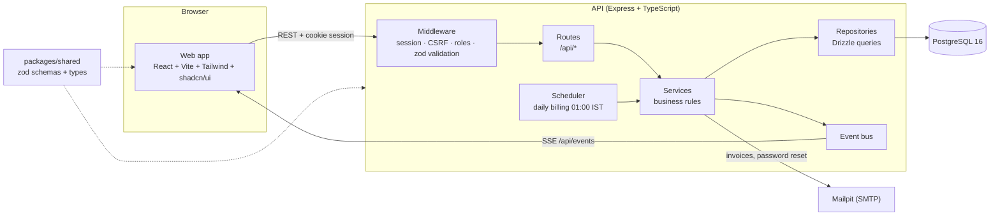

# Brightloop One

**Subscription billing for Indian businesses that can't afford to lose a rupee.**

Brightloop One runs the whole recurring-revenue loop (catalog, quotations, subscriptions,
daily billing, invoices, payments, credit notes, a customer portal) in INR with GST. Two
things set it apart:

- **Billing you can rerun safely.** A billing run can be repeated, retried after a crash or
  run for missed days, and it never invoices the same period twice.
- **Revenue integrity built in.** After every billing run a scanner looks for money that
  slipped through: subscriptions that were never billed, duplicate invoices and payments
  nobody allocated. Each finding shows its rupee impact and can be fixed in one click.

It runs at realistic scale: the demo dataset has **5,000 subscriptions and ~13,000 invoices**,
a full integrity scan takes **~260 ms**, and every list, report and portal endpoint answers
in well under 100 ms (see [Performance](#performance)).

Built for the Odoo x Makeaton hackathon.

## Quick start

Requirements: Docker Desktop.

```bash
docker compose up --build
```

| Service  | URL                                      |
| -------- | ---------------------------------------- |
| Web      | http://localhost:3000                    |
| API      | http://localhost:4000/api/health         |
| Mailpit  | http://localhost:8025 (all outgoing mail) |
| Postgres | localhost:5432 (brightloop / brightloop) |

The api container runs migrations and the base seed before starting. Source folders are
mounted, so edits hot-reload. Stop with `docker compose down`; add `-v` to wipe the database.

For the full 5,000-subscription demo, start with `SEED_DEMO=true docker compose up --build`
(see [Demo dataset](#demo-dataset)).

## Seeded logins

**Dev and demo only. Change or remove these accounts before any real deployment.**

| Role     | Email                                              | Password       |
| -------- | -------------------------------------------------- | -------------- |
| Admin    | `admin@brightloop.in`                              | `Admin@12345`  |
| Staff    | `priya@brightloop.in`, `arjun@brightloop.in`       | `Staff@12345`  |
| Customer | `customer01@example.in` … `customer20@example.in`  | `Customer@123` |
| Demo customer (`db:seed:demo` only) | `demo.customer@example.in` | `Demo@12345` |

- **Admin**: everything, including staff accounts, catalog and discount changes, credit notes
  and resolving integrity findings.
- **Staff**: customers, subscriptions, billing runs, invoices, payments and reports; read-only
  catalog and templates; can review and dismiss findings.
- **Customer**: the self-service portal only, scoped to their own customer record.

The base seed (`pnpm db:seed`, run on every api container start, skipped if
`admin@brightloop.in` exists) also creates:

- **Taxes:** GST 18% (exclusive) and GST 12% (inclusive)
- **Products:** Brightloop ERP, Cloud Hosting and Support Plan, two variants each.
  The Brand attribute's **Odoo** value adds ₹560.00 (56000 paise) to the ERP price.
- **Plans:** Monthly (pausable), Quarterly, Annual (can't close early, min 5 seats),
  Weekly Trial (auto-closes, not renewable, available during 2026)
- **Quotation templates:** Starter ERP (Monthly, 15 days) and Enterprise Odoo Bundle (Annual, 30 days)

## Demo guide

A five-minute walkthrough on the demo dataset (`--with-faults`):

1. **Finance dashboard** (admin): MRR, overdue total, aging buckets and upcoming renewals,
   computed in SQL over the full dataset.
2. **Subscriptions → new from template**: create a subscription from *Starter ERP*, confirm
   and move it through its lifecycle (draft → quotation → confirmed → active → paused / closed).
3. **Billing runs → dry run**: preview what today's run would invoice without writing
   anything. Then run it **live**, and run it **again**: the second run reports every
   subscription as `already_billed` and creates nothing.
4. **Revenue integrity**: the three planted faults are waiting, each with its rupee impact.
   Resolve the missing invoice with *Generate invoice* and the unallocated ₹5,000 payment
   with *Allocate payment*; both go through the real billing and payment services.
5. **Invoices and payments**: open an overdue invoice, download the PDF, record a partial
   payment, issue a credit note. The dashboard updates live over server-sent events.
6. **Customer portal**: sign in as `demo.customer@example.in` to see subscriptions,
   invoices (with PDFs) and payments, and raise a request. Customers only ever see their own data.

## Architecture



```
apps/api          Express + TypeScript + Drizzle API
apps/web          React + Vite + Tailwind + shadcn/ui
packages/shared   Shared zod schemas and types (used by api and web)
database/         Migrations
```

Rules the code follows: money is always integer paise, never floats. Every request goes
routes → zod validation → auth middleware → services → repositories → database, and business
rules live only in services. Every state change that matters writes an audit row.

## API overview

All endpoints are under `/api`, use a cookie session and require a CSRF header on writes
(fetch it from `GET /api/auth/csrf`). Lists accept `page`, `pageSize`, `sort` and filters, and
return `{ data, total, tookMs }`.

| Area | Endpoints | Who |
| ---- | --------- | --- |
| Auth | `POST /auth/register` `/login` `/logout` `/forgot-password` `/reset-password`, `GET /auth/me` `/auth/csrf` | anyone |
| Staff and customers | `POST /staff` (admin), `GET/POST/PATCH/DELETE /customers` | admin, staff |
| Catalog | `/products` (+ attributes and values), `/variants`, `/taxes`, `/plans` | read: staff, write: admin |
| Discounts | `/discounts` | admin |
| Quotations | `/quotation-templates` | read: staff, write: admin |
| Subscriptions | `GET/POST /subscriptions`, `POST /subscriptions/from-template/:id`, `POST /subscriptions/:id/transition` | admin, staff |
| Billing | `POST /billing/runs?mode=dry\|live`, `GET /billing/runs`, `GET /billing/runs/:id` | admin, staff |
| Invoices | `GET/PATCH /invoices`, `POST /invoices/:id/confirm` `/cancel` `/send` `/credit-notes`, `GET /invoices/:id/pdf` | admin, staff (credit notes: admin) |
| Payments | `GET/POST /payments`, `POST /payments/:id/allocations` | admin, staff |
| Reports | `GET /reports/summary` `/aging` `/collections` `/renewals` | admin, staff |
| Integrity | `POST /integrity/scan`, `GET /integrity/findings`, `POST /integrity/findings/:id/dismiss` `/resolve` | admin, staff (resolve: admin) |
| Audit | `GET /audit` | admin |
| Portal | `GET /portal/profile` `/subscriptions` `/invoices` `/invoices/:id` `/invoices/:id/pdf` `/payments`, `POST /portal/requests` | customer (own data only) |
| Live updates | `GET /events` (server-sent events) | signed in; admin and staff get every event, customers only events for their own customer |
| Health | `GET /health` | anyone |

## How billing idempotency works

A billing run invoices every active subscription whose `next_invoice_date` is on or before
the business date (Asia/Kolkata). It runs daily at 01:00 from the scheduler, or on demand.

- **One invoice per period, enforced by the database.** `invoices` has a unique constraint
  on `(subscription_id, period_start)`. The run never trusts its own bookkeeping alone: if
  an invoice for that period already exists, the insert fails, the run records the period as
  `already_billed` with the existing invoice number, and moves on.
- **One transaction per period.** Each period locks its subscription row (`SELECT … FOR
  UPDATE`), builds the invoice inside a savepoint and advances `next_invoice_date` in the
  same transaction. Two runs racing on the same subscription serialize on the lock; a crash
  mid-run leaves every finished period committed and the rest untouched, so rerunning simply
  continues.
- **Catch-up.** If the scheduler missed days, one run bills each overdue period in order
  (capped at 400 periods per subscription as a safety stop).
- **Failures are isolated.** An error on one subscription is recorded as a `failed` item and
  the run continues with the next.
- **Dry run.** `mode=dry` executes the exact same code inside a transaction that is rolled
  back, so the preview matches what a live run would do.
- **Every run is recorded** with per-subscription items (`created`, `already_billed`,
  `skipped`, `failed`) and finishes with an integrity scan.

The test suite checks this directly: rerunning a run, and even rewinding
`next_invoice_date`, creates zero duplicate invoices.

## How integrity rules work

The scanner (`POST /api/integrity/scan`, and automatically after every live billing run)
evaluates a set of SQL detection rules in one transaction, under an advisory lock so two
scans never overlap. Each rule returns one row per offending record:

| Rule | Severity | Detects | Impact |
| ---- | -------- | ------- | ------ |
| `missing_invoice` | high | An active subscription whose next invoice date is more than a day past, with no non-cancelled invoice for that period | the period's amount |
| `duplicate_invoice` | high | A non-cancelled invoice whose billing period overlaps the period of an earlier non-cancelled invoice for the same subscription; the earliest is the original, each later one is a finding (recommended action: void the duplicate) | the duplicate's total |
| `unallocated_payment` | medium | A payment whose allocations add up to less than its amount | the unallocated amount |

Exact duplicates (same subscription, same `period_start`) can't exist at all: the
`invoices_subscription_period_unique` constraint blocks them, which is also what makes billing
runs idempotent. `duplicate_invoice` catches what the constraint can't: invoices whose periods
overlap without starting on the same day, such as an invoice shifted by one day. Periods are
compared as half-open ranges `[period_start, period_end)`, so back-to-back periods don't count.

A finding is identified by `(rule, record)`, so rescans update it instead of creating
copies. When the underlying problem goes away, the next scan resolves the finding on its own;
if it comes back, the finding reopens. People move findings through **open → confirmed →
dismissed / resolved**, with a note, and every change is logged on the finding and in the audit log.

Two resolutions fix the data instead of only recording a decision, and they go through the
normal services so all the usual checks apply: **Generate invoice** bills the missing period
through the billing service, and **Allocate payment** allocates the payment through the
payments service.

On the demo dataset (5,000 subscriptions, ~13,000 invoices) a full scan takes **~260 ms**.

## Demo dataset

`pnpm db:seed:demo` loads a large, realistic dataset on top of the base seed, created
entirely through the services (no invoice or payment is written with SQL):

- ~300 customers and **5,000 subscriptions** over the Monthly, Quarterly, Annual and Weekly
  Trial plans, started over the last 6 months. About 3% are closed (including trials that
  auto-closed at the end of their term) and 2% are paused.
- Six months of invoice history, **~13,000 invoices**. The script replays the calendar: the
  services get an injected clock and the real live billing run is called for every business
  day, the way the daily scheduler would have run. All invoices are confirmed.
- Payments through the payments service: ~70% of invoices fully paid, ~15% partly paid,
  ~15% unpaid, so that about 10% of invoices are overdue today.
- It ends with an integrity scan and prints counts, the overdue total, the runtime and the
  open findings: 0 without `--with-faults`, exactly 3 with it.

```bash
pnpm db:seed:demo --reset --with-faults   # about 6 minutes for 5,000 subscriptions
```

| Flag            | Effect                                                                     |
| --------------- | -------------------------------------------------------------------------- |
| `--reset`       | Truncate every table except `settings` (document counters restart at 1), then run the base seed |
| `--with-faults` | Plant three faults for the integrity scan (see below)                       |
| `--subs=<n>`    | Number of subscriptions (default 5000)                                      |

Without `--reset` the script refuses to run when the demo customer already exists.

**Demo customer** (portal login): `demo.customer@example.in` / `Demo@12345` (Sunrise Demo
Pvt Ltd). It has 3 subscriptions (Monthly Starter ERP, Quarterly Growth ERP, Monthly
Hosting), one partly paid invoice that is not yet due, and one overdue invoice.

**Planted faults** (`--with-faults`), each detected by an integrity rule:

- `missing_invoice`: an active Starter ERP subscription that started 10 days ago and was never billed.
- `duplicate_invoice`: a second confirmed invoice for the same subscription as a paid
  invoice, with its period starting one day later and ending on the same day. It goes in
  through the normal invoice path, which `invoices_subscription_period_unique` allows
  because the period starts differ; the scan flags it because the two periods overlap.
  The constraint is never altered: the script refuses to run if it is missing.
- `unallocated_payment`: a ₹5,000 bank transfer with no allocation.

**Docker:** with `SEED_DEMO=true` the api container runs `db:seed:demo --reset --with-faults`
after the base seed. This happens on **every** container start and wipes the data each time.
Default `false`.

## Performance

With the API running and the demo dataset loaded, `pnpm perf:check` signs in as the admin
and as the demo customer, calls every list, report and portal endpoint with typical filters
5 times each, and prints the median and max wall time plus the server's `tookMs`. It exits
non-zero if any endpoint misses the target (median < 500 ms, max < 2000 ms).
Options: `--base=http://localhost:4000`, `--runs=5`, `--save=before.json`, `--compare=before.json`.

Measured on the demo dataset (5,056 subscriptions, 13,279 invoices, 11,255 payments,
326 customers), local Docker, 5 runs each, times in ms:

| Endpoint | Median | Max | `tookMs` | Rows |
| -------- | -----: | --: | -------: | ---: |
| subscriptions | 13.3 | 13.8 | 5.4 | 5056 |
| subscriptions active | 20.3 | 21.9 | 12.2 | 4795 |
| subscriptions by customer | 10.6 | 14.8 | 3.2 | 13 |
| subscriptions by plan | 9.7 | 10.7 | 4.3 | 739 |
| subscriptions expiring 60d | 7.1 | 7.8 | 2.6 | 68 |
| subscriptions page 100 | 18.5 | 21.3 | 13.9 | 5056 |
| invoices | 9.5 | 12.0 | 4.5 | 13279 |
| invoices overdue | 11.6 | 12.0 | 5.5 | 1335 |
| invoices confirmed | 8.2 | 8.7 | 3.7 | 3983 |
| invoices by customer | 7.0 | 8.7 | 2.4 | 31 |
| invoices last 30d | 8.4 | 8.6 | 3.6 | 3529 |
| invoices page 300 | 21.2 | 22.1 | 16.5 | 13279 |
| payments | 7.2 | 8.9 | 2.5 | 11255 |
| payments by customer | 6.8 | 15.6 | 2.0 | 26 |
| payments unallocated | 34.9 | 36.6 | 31.4 | 5 |
| payments last 30d | 6.8 | 7.2 | 2.6 | 3808 |
| customers | 5.8 | 6.6 | 1.5 | 326 |
| customers search | 7.1 | 8.0 | 2.7 | 29 |
| customers by city | 5.6 | 6.5 | 1.7 | 26 |
| reports/summary | 47.4 | 51.1 | 43.0 | – |
| reports/summary 6 months | 50.1 | 51.8 | 46.4 | – |
| reports/summary customer | 6.7 | 8.7 | 3.1 | – |
| reports/aging | 20.2 | 21.8 | 16.6 | – |
| reports/collections | 16.9 | 19.4 | 13.1 | – |
| reports/renewals | 7.7 | 10.1 | 3.3 | – |
| integrity/findings | 6.8 | 8.5 | 2.4 | 22 |
| integrity/findings open | 6.9 | 8.5 | 2.5 | 17 |
| billing/runs | 5.3 | 6.7 | 1.7 | 661 |
| audit | 10.5 | 13.0 | 6.0 | 51203 |
| portal/profile | 5.1 | 5.6 | – | – |
| portal/subscriptions | 5.8 | 6.3 | – | – |
| portal/invoices | 5.7 | 6.3 | – | – |
| portal/invoices/:id | 7.5 | 9.1 | – | – |
| portal/payments | 6.7 | 7.1 | – | – |

All endpoints meet the target. The slowest is the finance summary at ~50 ms.

## Run locally

Requirements: Node 20+, pnpm, and Postgres (e.g. `docker compose up -d postgres mailpit`).

```bash
pnpm install
cp .env.example .env
pnpm db:migrate
pnpm db:seed
pnpm dev
```

## Scripts

| Command            | What it does                                   |
| ------------------ | ---------------------------------------------- |
| `pnpm dev`         | Run api and web in watch mode                  |
| `pnpm build`       | Build every package                            |
| `pnpm lint`        | Lint the whole repo with ESLint                |
| `pnpm test`        | Run Vitest in every package (API integration tests need the Postgres in `DATABASE_URL`) |
| `pnpm typecheck`   | Type-check every package                       |
| `pnpm db:generate` | Generate a migration from the Drizzle schema   |
| `pnpm db:migrate`  | Apply migrations in `database/migrations`      |
| `pnpm db:seed`     | Run the base seed                              |
| `pnpm db:seed:demo`| Load the demo dataset (see "Demo dataset")     |
| `pnpm perf:check`  | Time every list/report/portal endpoint of a running API (see "Performance") |

CI (`.github/workflows/ci.yml`) runs lint, typecheck and the full Vitest suite against a
fresh Postgres 16 on every pull request.

## Team

Built solo by Mohammed Hassan during the hackathon. Every change went through a feature
branch, a pull request and CI, the same workflow a team would use.

See [CONTRIBUTING.md](CONTRIBUTING.md) for branch and PR rules.
